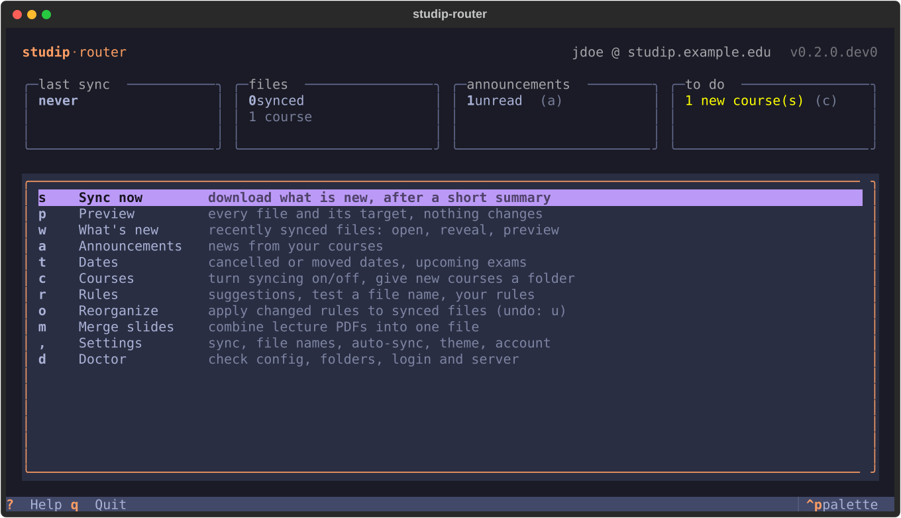
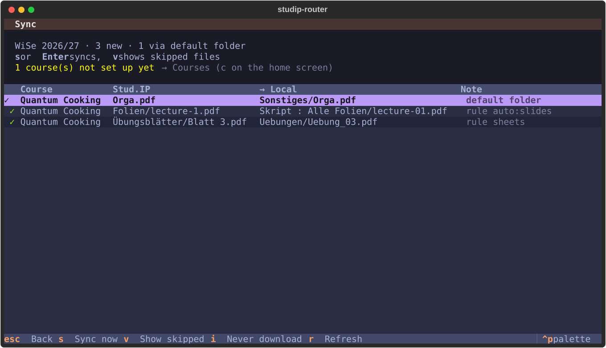
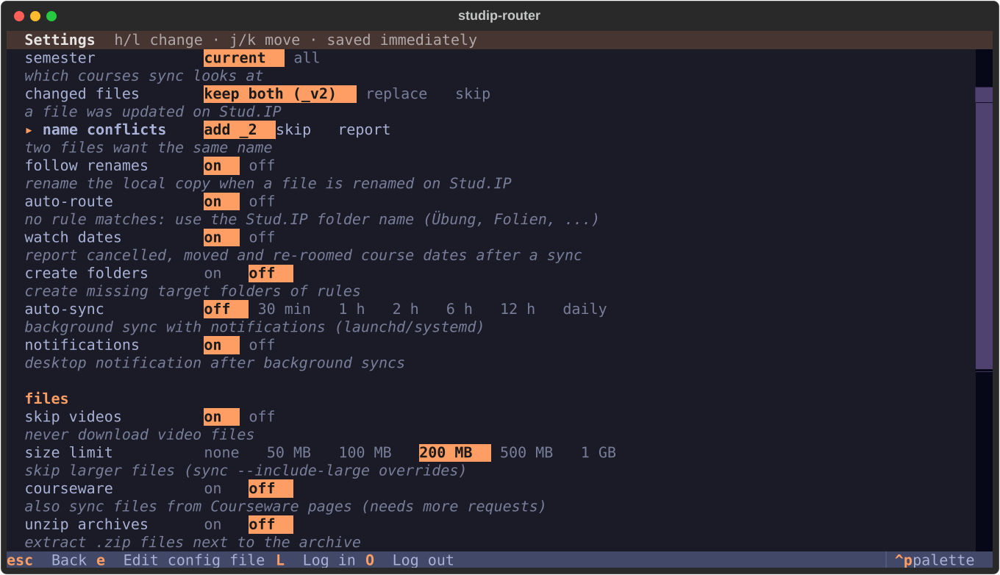
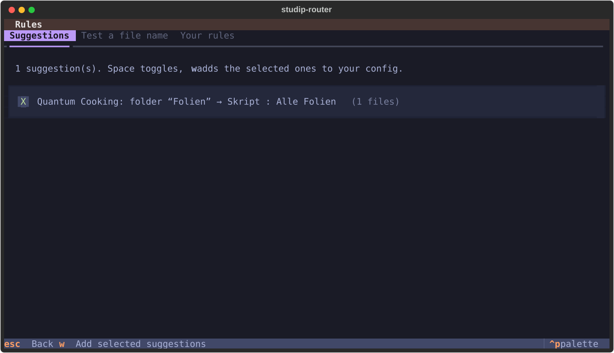
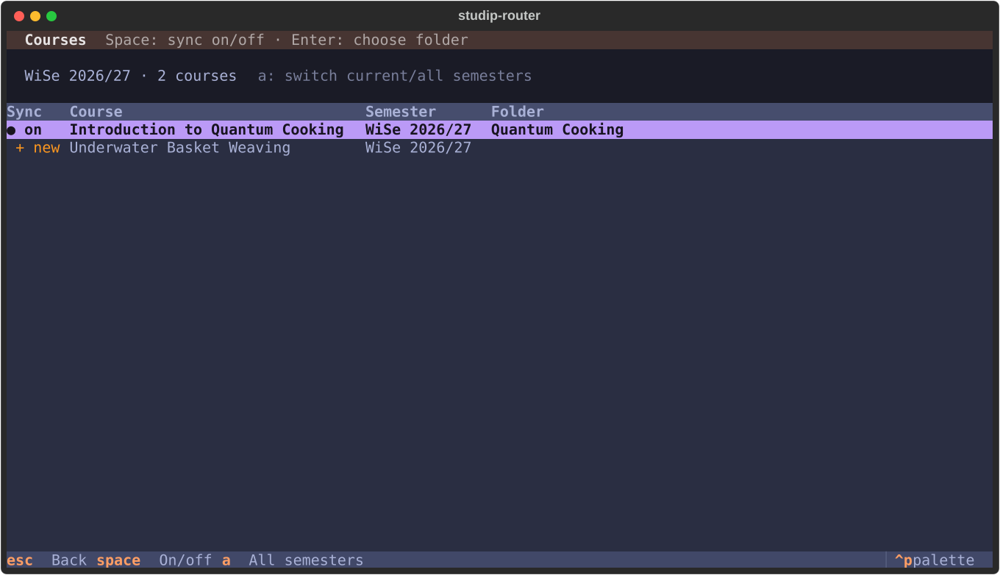
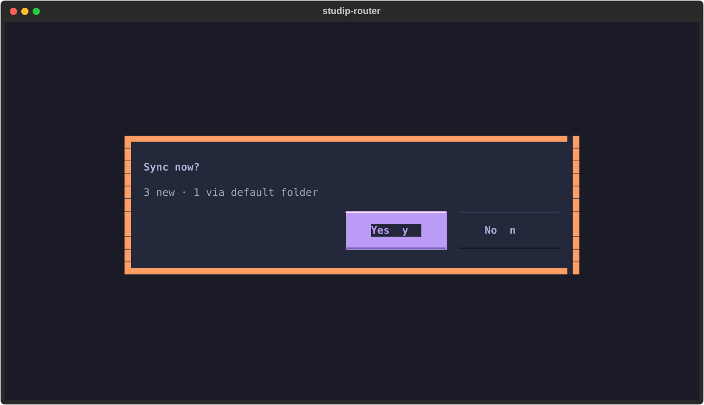
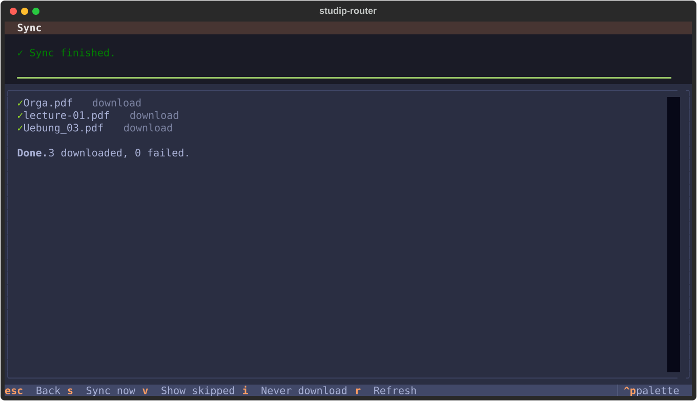

# studip-router — Stud.IP files, sorted into *your* folders

[Terms](#terms-in-one-sentence) ·
[Quick start](#quick-start) ·
[Usage](#usage) ·
[Configuration](#configuration) ·
[Commands](#command-reference) ·
[FAQ](#faq) ·
[Troubleshooting](#troubleshooting)

[](https://github.com/nbomers/studip-router/actions/workflows/ci.yml)
[](#installation)
[](#requirements)
[](LICENSE)
[](#how-it-stays-safe)

**Course files in, your folder structure out.** Most Stud.IP downloaders mirror
the course's folder tree. `studip-router` files every document into the folders
you already use — whatever you call them (`Exercises`, `Übungen`, `Hausaufgaben`,
`Slides`, `Skript`, `Exams/Past papers`, …) — with per-course rules, because every
lecturer organises their course differently:

```bash
studip
```

Press `s`, confirm the one-line summary, done. A second run downloads nothing
unless something changed on Stud.IP.



<sub>The home screen: status cards on top, every common action on one key.
All course names in the screenshots are made up.</sub>

> [!IMPORTANT]
> **Needs a Stud.IP password.** The tool logs in to the Stud.IP JSON:API with
> username and password (local or LDAP accounts). Accounts that only log in via
> SSO (Shibboleth/OIDC) or with two-factor authentication are
> [not supported yet](#requirements).

---

## Contents

1. [Terms in one sentence](#terms-in-one-sentence)
2. [Features](#features)
3. [Quick start](#quick-start)
4. [Requirements](#requirements) · [Installation](#installation)
5. [Usage](#usage)
6. [Configuration](#configuration)
7. [Command reference](#command-reference)
8. [How it stays safe](#how-it-stays-safe)
9. [Tricky files](#tricky-files)
10. [FAQ](#faq)
11. [Troubleshooting](#troubleshooting)
12. [Development](#development) · [Use of AI](#use-of-ai) · [Credits](#credits) · [License](#license)

---

## Terms in one sentence

| Term | Meaning |
|---|---|
| **Root** | The folder that contains your course folders, e.g. `~/Uni/Semester 5` (`sync.root`). |
| **Target** | Where a course or a rule puts its files, relative to the root or the course folder. |
| **Rule** | A per-course *if this file looks like X, put it into folder Y and name it Z*. **First match wins.** |
| **Default folder** | Where files go that no rule matches (`sync.default_target`, e.g. `Sonstiges`). |
| **Suggestion** | A rule the tool proposes by comparing Stud.IP folder names with your local folder names (German and English). |
| **Adopt** | A file you already downloaded by hand is *recorded* instead of downloaded a second time. |
| **Version** | A file that changed on Stud.IP is saved as `name_v2.pdf` next to the old one; nothing is replaced. |
| **Dry run** | Shows exactly what a sync would do without touching anything — it uses the same planner as the real run. |
| **Profile** | A separate config and state, e.g. for a second university (`--profile NAME`). |

---

## Features

| | |
|---|---|
| **One key to sync** | run `studip`, press `s`, confirm the summary. |
| **Incremental** | only new or changed files are downloaded; a second run does nothing. |
| **Rule-based routing** | per course, first match wins: Stud.IP folder, folder type, file name (glob/regex), extension, MIME type, size, date, description. |
| **Rule suggestions** | understand German and English folder names on both sides (`Übungsblätter`, `Homework`, `Tutorium …` → your `Exercises`/`Übungen`/… folder) — including courses with one folder per session. |
| **Renaming** | templates with regex groups (`Blatt (\d+)` → `Exercise_{1:02}{ext}`), zero padding, umlauts, spaces, prefixes. |
| **Settings screen** | every option on one page, change with ←/→ (or `h`/`l`), saved immediately — comments in your config file are kept. |
| **Knows your existing files** | hand-downloaded files are recognised (even as `Name_with_underscores.pdf`); a file you moved within the course folder is followed. |
| **Updates become versions** | a changed file becomes `name_v2.pdf` (configurable). Renames, moves and re-uploads of the *same* content never create copies. |
| **Robust** | a failing course is reported while all others still sync; messy names, interrupted transfers, HTML error pages, broken ZIPs and iCloud are handled — see [tricky files](#tricky-files). |
| **Background sync** | with desktop notifications, also about problems; a failed login pauses it so a changed password cannot lock your account. |
| **Extras** | Courseware files (opt-in), announcements, ZIP extraction, merged slide PDFs, never-download list, `--json` output, profiles. |

---

## Quick start

```bash
uv tool install git+https://github.com/nbomers/studip-router
```

```bash
studip
```

The first start opens a short setup: Stud.IP address, username, password
(stored in your OS keychain), and the folder that contains your course folders.
It matches your courses to your folders, then you are on the home screen.

**Recommended first steps:** `r` → add the suggested rules → `p` to check → `s` to sync.

<sub>One block, one command: the copy icon takes exactly one call.</sub>

---

## Requirements

- Python 3.11+, macOS or Linux. Windows should work but is untested.
- A Stud.IP instance with the **JSON:API enabled** and **username/password login**
  (local or LDAP accounts). Check: `https://<your-studip>/jsonapi.php/v1/discovery`
  must open in a browser.
- SSO-only accounts (Shibboleth/OIDC without a Stud.IP password) and two-factor
  authentication are not supported yet — contributions welcome, see
  [docs/DESIGN.md](docs/DESIGN.md).

## Installation

| Tool | Install | Update |
|---|---|---|
| [uv](https://docs.astral.sh/uv/) | `uv tool install git+https://github.com/nbomers/studip-router` | `uv tool upgrade studip-router` |
| [pipx](https://pipx.pypa.io/) | `pipx install git+https://github.com/nbomers/studip-router` | `pipx upgrade studip-router` |

> [!TIP]
> Working on the code? Avoid an editable install from an iCloud/Dropbox folder for
> daily use: if the sources are evicted, the command stops working.
> `studip doctor` warns about it.

<details>
<summary><b>Shell integration (fish)</b></summary>

```bash
cp shell/fish/completions/studip.fish ~/.config/fish/completions/
```

Completes subcommands, flags and your course folders.
`shell/fish/functions/studip.fish` is an optional wrapper for running from a
source checkout.

</details>

---

## Usage

### The terminal UI

| Key | | Key | |
|---|---|---|---|
| `s` | **Sync now** (summary → confirm) | `r` | Rules: suggestions, test a file name |
| `p` | Preview every file and its target | `o` | Reorganize synced files (`u` undo) |
| `w` | What's new: open / reveal / preview | `m` | Merge slides into one PDF |
| `a` | Announcements | `,` | Settings |
| `c` | Courses: sync on/off, choose folders | `d` | Doctor: check the setup |
| `i` | in preview / what's new: never download this file | `?` | all keys |

`j`/`k` and arrow keys move, `Enter` opens, `Esc` goes back.

<p align="center">
  
  
</p>

<sub>Left the preview — every file, its target and the rule that placed it.
Right the settings — saved immediately, comments in the config file are kept.</sub>

<details>
<summary><b>More screenshots</b>: rule suggestions, courses, sync</summary>

<p align="center">
  
  
</p>
<p align="center">
  
  
</p>

</details>

### The command line

Everything works without the UI:

```bash
studip init
```

```bash
studip rules suggest --write
```

```bash
studip sync --dry-run
```

```bash
studip sync
```

Setup, add the suggested rules, see exactly what would happen, do it.

---

## Configuration

The config lives at `~/.config/studip-router/config.toml` (`studip config path`).
Most options are in the settings screen; rules are written in the file. The fully
commented reference is **[config.example.toml](config.example.toml)**.

```toml
[server]
base_url = "https://studip.example.edu"
username = "jdoe"                         # password: OS keychain only

[sync]
root = "~/Uni/Semester 5"
default_target = "Misc"                   # where files go that no rule matches

[courses.0123456789abcdef0123456789abcdef]   # Stud.IP course ID (`studip courses`)
name = "Quantum Cooking"
target = "Quantum Cooking"

[[courses.0123456789abcdef0123456789abcdef.rules]]
id = "sheets"
match = { folder = "Übungsblätter*", name_regex = '(?:blatt|sheet)[ _]?(\d+)' }
target = "Exercises"
rename = "Exercise_{1:02}{ext}"
```

Test a rule without downloading anything (also in the UI under `r`):

```bash
studip rules test quantum "Blatt 7.pdf" --folder "Übungsblätter"
```

```text
Rule sheets
  → ~/Uni/Semester 5/Quantum Cooking/Exercises/Exercise_07.pdf
```

> [!TIP]
> **Changed your rules after syncing?** `studip reorganize --dry-run` shows how
> synced files would move, `studip reorganize` moves them, `studip undo` moves
> them back.

<details>
<summary><b>Settings reference</b></summary>

| Key | Default | Meaning |
|---|---|---|
| `sync.semester` | `"current"` | `"current"`, `"all"` or a title like `"WiSe 2026/27"` |
| `sync.on_update` | `"version"` | changed remote file: `version` (`_v2`), `overwrite`, `skip` |
| `sync.on_conflict` | `"suffix"` | two files, same name: `suffix` (`_2`), `skip`, `error` |
| `sync.default_target` | `"Sonstiges"` | folder for files no rule matches (`init` detects yours) |
| `sync.create_missing_dirs` | `false` | create rule target folders that do not exist |
| `sync.unzip` | `false` | extract `.zip` downloads next to the archive |
| `sync.notify` | `true` | notification after background syncs |
| `sync.follow_renames` | `true` | rename the local copy when a file is renamed on Stud.IP |
| `sync.courseware` | `false` | also sync files from Courseware pages (per course: `courses.<id>.courseware`) |
| `sync.only_configured_courses` | `true` | `false`: sync every course into a folder named like it |
| `sync.exclude` | videos, > 200 MB | `globs`, `mime`, `max_size_mb` (`0` = no limit) |
| `rename.pad_numbers` | `2` | `lecture-1` → `lecture-01`; `0` disables |
| `rename.spaces` / `umlauts` / `lowercase` | keep | `_` or `-` / `transliterate` / `true` |
| `rename.portable` | `true` | replace `: * ? " < > \|` (Windows, OneDrive, iCloud) |
| `rename.strip_prefixes` | `[]` | e.g. `["Vorlesung_"]` |
| `ui.theme` | `"tokyo-night"` | terminal UI colours |
| `courses.<id>.exclude` | `false` | never touch this course |
| `courses.<id>.merge` | – | `{ source = "Slides", output = "All slides.pdf" }` |

From scripts: `studip config set sync.on_update skip`.

</details>

---

## Command reference

| Command | |
|---|---|
| `studip` | terminal UI |
| `studip sync [--dry-run] [--course X] [--semester S] [--include-large]` | sync |
| `studip courses` | courses with status active / excluded / new |
| `studip status` | new courses, files only placed by the default folder |
| `studip rules list / test / suggest [--write]` | inspect and create rules |
| `studip reorganize` / `studip undo` | apply changed rules to synced files / revert |
| `studip history` / `studip news` | recently synced files / unread announcements |
| `studip merge` | merge slide PDFs |
| `studip schedule install --every 120` / `run-now` / `uninstall` | background sync (opt-in) |
| `studip ignore add / list / remove` | files you never want |
| `studip doctor [--test-notification]` | check config, folders, keychain, server, scheduler |
| `studip auth login / status / logout` | password in the OS keychain |
| `studip config path / validate / edit / set` | config file |

**Global options:** `--profile NAME` (separate config + state, e.g. a second
university), `--json` (machine-readable output for scripts, Raycast, Alfred, …).

---

## How it stays safe

| Promise | How |
|---|---|
| **Nothing is ever deleted** | files removed on Stud.IP are only reported. |
| **Nothing is overwritten unnoticed** | name clashes get a suffix, updates become `_v2`; `overwrite` mode never replaces a file you edited (size/mtime/hash check against the state). |
| **Dry run == real run** | both use the same planner; the real run only executes the plan. |
| **Downloads are atomic** | `name.part`, fsync, rename. Ctrl-C leaves no partial files. |
| **Your password stays put** | only in the OS keychain — never in the config, state, logs or output. |
| **Config edits are checked** | settings screen and rule suggestions validate before writing; the first change keeps a `config.toml.bak`. |

Found a security problem? See [SECURITY.md](SECURITY.md).

---

## Tricky files

<details>
<summary><b>What happens with odd names, broken downloads, iCloud & co.</b></summary>

| Situation | What happens |
|---|---|
| `:` `*` `?` `"` `<` `>` `\|` in names | replaced (`Kapitel 1: Intro` → `Kapitel 1 - Intro`), so the folder also syncs to Windows/OneDrive/iCloud for Windows (`rename.portable`) |
| names longer than 255 bytes (umlauts count twice) | shortened, extension kept, room left for `_v2` |
| `/`, control characters, leading dot, trailing dots/spaces, `CON`/`NUL`… | made safe |
| `&amp;` & co. in Stud.IP names | decoded |
| file without extension | added from the MIME type (`Blatt 1` + PDF → `Blatt 1.pdf`) |
| upper/lower case, NFC/NFD (`ü` vs `u` + `¨`) | treated as the same name; no duplicates |
| two files want the same name | `name_2.pdf` (or skip/report) |
| hand-downloaded `Homework_1.pdf` vs `Homework 1.pdf` on Stud.IP | recognised as the same file |
| interrupted download, wrong size | retried; never leaves half files |
| Stud.IP sends a login/error page instead of the file | rejected and reported, retried next time |
| Stud.IP reports a wrong size | accepted once two downloads agree |
| one file fails | the others continue; the failed one is retried next sync |
| files only in iCloud (also old `.name.icloud` placeholders) | never downloaded just to compare |
| ZIPs with garbled umlaut names, ZIP-slip, ZIP bombs | names repaired, unsafe archives refused |
| `H2O`, `Python3`, `IPv6`, `A4`, `2x2` | left alone by number padding (only standalone numbers are padded) |
| renamed / moved / re-uploaded on Stud.IP | followed; identical content is never stored twice |
| two syncs at once (auto-sync + manual) | the second one stops with a message instead of racing |
| crash or power loss mid-download | leftover temp files are cleaned up after a day |
| university CA or TLS-inspecting proxy | the operating system's certificate store is used |
| link to an external site redirects elsewhere | your credentials are never sent to the other host |

</details>

---

## FAQ

<details>
<summary><b>My folders have different names than in the examples.</b></summary>

That's the point: targets are whatever folders you have. `studip init` and the
rule suggestions detect them (German and English, with or without umlauts) and
never pick archive folders like `old` or `Archiv`.

</details>

<details>
<summary><b>I already downloaded files by hand. Will they be downloaded twice?</b></summary>

No. A file with the same name (spaces, `_`, `-` treated alike) and size anywhere
in the course folder is recorded instead. A same-named file with different
content that you fetched this semester is treated as an older version: the new
one goes next to it as `_v2`.

</details>

<details>
<summary><b>I deleted a file locally. Will it come back?</b></summary>

Yes, the next sync downloads it again. Files you never want: press `i` on them
(preview or what's new), `studip ignore add NAME`, a rule with `skip = true`, or
`sync.exclude`.

</details>

<details>
<summary><b>The lecturer renamed or re-uploaded a file. Do I get duplicates?</b></summary>

No. A rename or move on Stud.IP renames your local copy (unless you edited it).
A re-upload under the same name becomes `name_v2.pdf` — or nothing at all if the
content is identical.

</details>

<details>
<summary><b>What happens at the end of the semester?</b></summary>

Courses you set up keep syncing (retake exams, late solutions) until you switch
them off under `c`. Courses of the next semester show up as "new" a few weeks
before it starts. For a new semester folder, point `sync.root` to it
(`studip config set sync.root "~/Uni/Semester 6"`) or give courses absolute
targets. Older semesters: `studip sync --semester "SoSe 2026"`, `--semester all`,
or `a` in the courses screen.

</details>

<details>
<summary><b>Does it get the files inside Courseware?</b></summary>

Turn on *courseware* in the settings (or per course in the config).
`studip doctor` tells you which of your courses use Courseware. Videos are
skipped by default (*skip videos*).

</details>

<details>
<summary><b>iCloud: evicted files, two Macs, <code>Skript / Alle Folien</code></b></summary>

- **Files "optimised" away** are fine: evicted files are never downloaded for
  comparison. Keep the state outside synced folders (the default).
- **Two Macs with the same iCloud folder:** run auto-sync on one of them only;
  two machines downloading the same file at the same time make iCloud create
  "Name 2.pdf" conflict copies.
- **A folder is called `Skript / Alle Folien` in Finder** but the tool says it
  does not exist: macOS shows `:` as `/` in Finder. On disk it is
  `Skript : Alle Folien` — use that in the config. `studip doctor` points this out.

</details>

---

## Troubleshooting

| Problem | Fix |
|---|---|
| `authentication failed (HTTP 401)` | `studip auth login` (or `L` in settings); your account needs a Stud.IP password, not SSO-only |
| `JSON:API not available (HTTP 404)` | the JSON:API is disabled at your university; ask the Stud.IP admins |
| `target folder does not exist` | create it, fix the rule target, or turn on *create folders* in the settings |
| `received an HTML page instead of the file` | log in to Stud.IP in the browser and check the file is accessible |
| `another studip-router run is in progress` | auto-sync is running right now; try again in a minute |
| `auto-sync paused after a failed login` | `studip auth login` (or `L` in the settings) resumes it |
| no notifications | `studip doctor --test-notification`; allow notifications for "Script Editor" in System Settings |
| background sync cannot read the password | `studip schedule run-now` and choose *Always Allow* when macOS asks for keychain access (again after `uv tool upgrade`) |
| a course is listed under "could not be read" | usually a temporary Stud.IP problem; the other courses were synced, the log has details |
| config errors | `studip config validate` names the exact key, e.g. `courses.<id>.rules[2].match.name_regex` |
| anything else | `studip doctor`, then the log at `~/.local/state/studip-router/studip-router.log` |

---

## Development

```bash
uv sync
```

```bash
uv run pytest
```

```bash
uv run ruff check . && uv run ruff format --check .
```

Ground rules, layout and conventions: [CONTRIBUTING.md](CONTRIBUTING.md).
Invariants, architecture and the Stud.IP API calls: [docs/DESIGN.md](docs/DESIGN.md).
Changes: [CHANGELOG.md](CHANGELOG.md).

## Use of AI

The code was written with Claude (Anthropic) via
[Claude Code](https://claude.com/claude-code); the commits say so in their
`Co-Authored-By` lines. What for:

- **Writing code** — modules, the terminal UI and the tests; run and checked
  with `pytest` and `ruff` before being adopted.
- **Review and debugging** — e.g. file names with decomposed umlauts (NFD) on
  Linux.
- **Documentation** — this README, the design notes and the changelog.

Tests run against a fake Stud.IP (`tests/fake_studip.py`); no real course data,
IDs or accounts are in the repository.

## Credits

| | License | Use |
|---|---|---|
| [Stud.IP](https://www.studip.de) JSON:API | — | the data source |
| [HTTPX](https://www.python-httpx.org) | BSD-3-Clause | HTTP client |
| [Typer](https://typer.tiangolo.com) | MIT | command line |
| [Textual](https://textual.textualize.io) | MIT | terminal UI |
| [keyring](https://github.com/jaraco/keyring) | MIT | password in the OS keychain |
| [tomlkit](https://github.com/python-poetry/tomlkit) | MIT | config edits that keep comments |
| [pypdf](https://github.com/py-pdf/pypdf) | BSD-3-Clause | merged slide PDFs |
| [platformdirs](https://github.com/tox-dev/platformdirs) | MIT | config, state and log paths |
| [truststore](https://github.com/sethmlarson/truststore) | MIT | the operating system's certificates |

## License

The code is under the [MIT license](LICENSE).

Not affiliated with the Stud.IP e.V. or any university.
