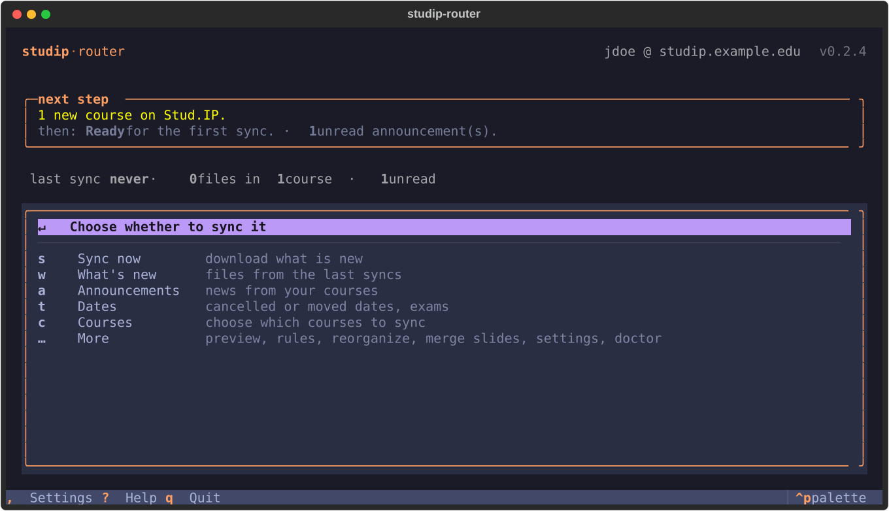
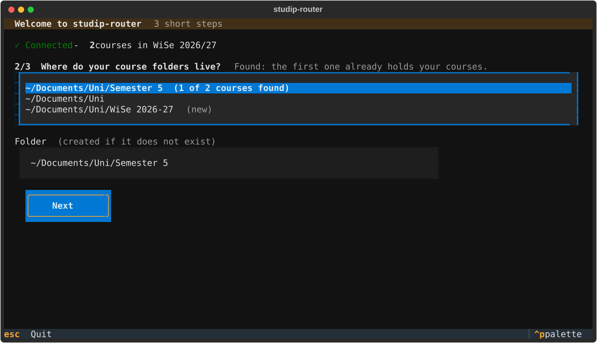
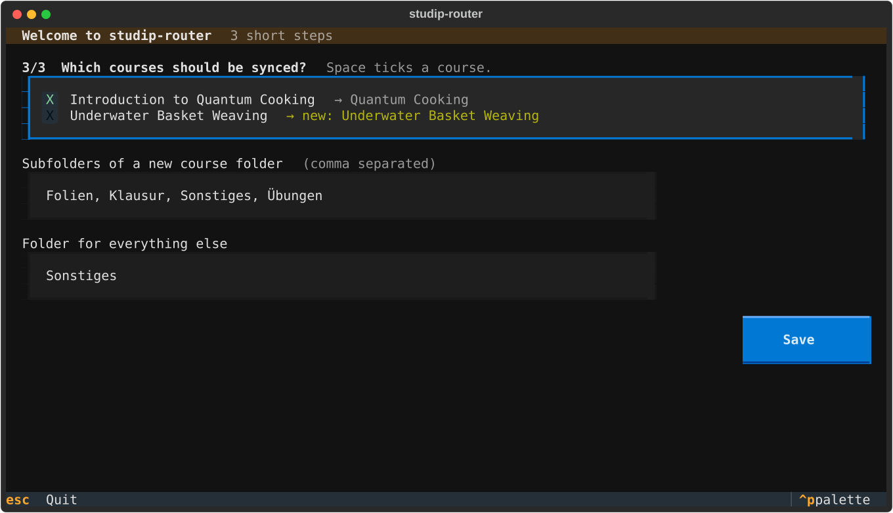

# studip-router — Stud.IP files, sorted into *your* folders

[Terms](docs/USAGE.md#terms-in-one-sentence) ·
[Quick start](#quick-start) ·
[Usage](docs/USAGE.md#usage) ·
[Configuration](docs/CONFIGURATION.md#configuration) ·
[Commands](docs/CONFIGURATION.md#command-reference) ·
[FAQ](docs/USAGE.md#faq) ·
[Troubleshooting](docs/TROUBLESHOOTING.md#troubleshooting)

[](https://github.com/nbomers/studip-router/actions/workflows/ci.yml)
[](#installation)
[](#requirements)
[](https://github.com/nbomers/studip-router/blob/main/LICENSE)
[](docs/USAGE.md#how-it-stays-safe)

**Course files in, your folder structure out.** Most Stud.IP downloaders mirror
the course's folder tree. `studip-router` files every document into the folders
you already use — whatever you call them (`Exercises`, `Übungen`, `Hausaufgaben`,
`Slides`, `Skript`, `Exams/Past papers`, …) — with per-course rules, because every
lecturer organises their course differently:

```bash
studip
```

Press `s`, confirm the one-line summary, done. A second run downloads nothing
unless something changed on Stud.IP.



<sub>The home screen: one suggested next step (Enter does it), five everyday
actions, the rest behind *More*.
All course names in the screenshots are made up.</sub>

> [!IMPORTANT]
> **Needs a Stud.IP password.** The tool logs in to the Stud.IP JSON:API with
> username and password (local or LDAP accounts). Accounts that only log in via
> SSO (Shibboleth/OIDC) or with two-factor authentication are
> [not supported yet](#requirements).

---

## Guides

- [Usage, keyboard shortcuts and common workflows](docs/USAGE.md)
- [Configuration and command reference](docs/CONFIGURATION.md)
- [Troubleshooting and recovery](docs/TROUBLESHOOTING.md)
- [Sorting, previews and language conventions](docs/USABILITY.md)
- [Security policy](SECURITY.md)

Course-specific routing rules and PDF merge settings are configured in TOML; the
settings screen covers the common options and groups the rest under Advanced.

## Features

| | |
|---|---|
| **One key to sync** | run `studip`, press `s`, confirm the summary. |
| **Incremental** | only new or changed files are downloaded; a second run does nothing. |
| **Rule-based routing** | per course, first match wins: Stud.IP folder, folder type, file name (glob/regex), extension, MIME type, size, date, description. |
| **Automatic routing** | a file no rule matches still lands in the right folder when its Stud.IP folder says what it is (`Übungen`, `Tutorium`, `Notebooks`, `Folien`, `Slides`, `Vorlesung`, …) — also for folders created mid-semester. |
| **Rule suggestions** | understand German and English folder names on both sides (`Übungsblätter`, `Homework`, `Tutorium …` → your `Exercises`/`Übungen`/… folder) — including courses with one folder per session. |
| **Renaming** | templates with regex groups (`Blatt (\d+)` → `Exercise_{1:02}{ext}`), zero padding, umlauts, spaces, prefixes. |
| **Settings screen** | essentials plus advanced options, change with ←/→ (or `h`/`l`), saved immediately; `u` undoes the last change — comments in your config file are kept. |
| **Knows your existing files** | hand-downloaded files are recognised (even as `Name_with_underscores.pdf`); a file you moved within the course folder is followed. |
| **Updates become versions** | a changed file becomes `name_v2.pdf` (configurable). Renames, moves and re-uploads of the *same* content never create copies. |
| **Robust** | a failing course is reported while all others still sync; messy names, interrupted transfers, HTML error pages, broken ZIPs and iCloud are handled — see [tricky files](docs/USAGE.md#tricky-files). |
| **Background sync** | with desktop notifications, also about problems; a failed login pauses it so a changed password cannot lock your account. |
| **Changed dates** | after each sync: cancelled, moved and re-roomed course dates and new exam dates — in the summary and as a notification; `studip dates` lists upcoming exams. |
| **Locked PDFs** | one shared PDF password per course (keychain) — PDFs locked with it are stored without it; see [FAQ](docs/USAGE.md#faq). |
| **Extras** | Courseware files (opt-in), announcements, ZIP extraction, merged slide PDFs, never-download list, `--json` output, profiles. |

---


## Quick start

```bash
uv tool install studip-router
```

```bash
studip
```

The first start opens a setup in three steps. Every field is prefilled with a
good guess, so usually you only press Enter:

| Step | Asks for | Prefilled with |
|---|---|---|
| **1/3** | Stud.IP address, username, password | — (the password goes to the OS keychain) |
| **2/3** | where your course folders live | the folder that **already contains most of your courses** — searched in iCloud Drive, Documents, Desktop, Dropbox, OneDrive, Google Drive, Nextcloud. Nothing found: a new `iCloud Drive/Uni/WiSe 2026-27` (without iCloud: `~/Documents/Uni/…`) |
| **3/3** | which courses to sync, the subfolders of new course folders, the default folder | the courses that already have a folder (all of them when starting fresh); the subfolders your existing course folders share — otherwise `Folien, Übungen, Klausur, Sonstiges` |

Missing folders are created after one confirmation, each course folder with the
same subfolders. Because their names say what they hold, files land in the right
one from the first sync on — no rules needed.

<p align="center">
  
  
</p>

**Then:** `p` shows where every file would go, `s` syncs. `studip init` is the
same setup in the terminal.

<sub>One block, one command: the copy icon takes exactly one call.</sub>

---


## Requirements

- Python 3.11+, macOS or Linux. **Windows is not supported** (not tested; background
  sync and notifications do not exist there).
- An OS keychain: macOS Keychain, or a Secret Service keyring on Linux (GNOME
  Keyring, KWallet). On servers, WSL or containers without one, set
  `STUDIP_ROUTER_PASSWORD` instead (see [Headless use](docs/TROUBLESHOOTING.md#troubleshooting)); the
  password is never stored in a file.
- A Stud.IP instance with the **JSON:API enabled** and **username/password login**
  (local or LDAP accounts). Check: `https://<your-studip>/jsonapi.php/v1/discovery`
  must open in a browser.
- SSO-only accounts (Shibboleth/OIDC without a Stud.IP password) and two-factor
  authentication are not supported yet — contributions welcome, see
  [docs/DESIGN.md](https://github.com/nbomers/studip-router/blob/main/docs/DESIGN.md).


## Installation

| Tool | Install | Update |
|---|---|---|
| [uv](https://docs.astral.sh/uv/) | `uv tool install studip-router` | `uv tool upgrade studip-router` |
| [pipx](https://pipx.pypa.io/) | `pipx install studip-router` | `pipx upgrade studip-router` |
| pip (in a [venv](https://docs.python.org/3/library/venv.html)) | `python3 -m venv ~/.venvs/studip && ~/.venvs/studip/bin/pip install studip-router` | `~/.venvs/studip/bin/pip install -U studip-router` |

**After an update** the background sync checks whether the new version would put
files you already have into other folders. If so, it waits (at most three days)
and sends one notification; opening `studip` or one `studip sync` by hand ends the
wait, and `o` moves the files if you agree.

`uv` and `pipx` put the `studip` command on your `PATH` and keep it apart from other
Python packages. Plain `pip install studip-router` into the system Python is refused
by Homebrew and most Linux distributions ("externally-managed-environment"); with a
venv, call `~/.venvs/studip/bin/studip` or link it into a folder on your `PATH`.

Releases come from [PyPI](https://pypi.org/project/studip-router/), built and
uploaded by this repository's GitHub Actions ([changes](https://github.com/nbomers/studip-router/blob/main/CHANGELOG.md)). A specific
version: `uv tool install studip-router==0.2.1`. No `uv` yet? See its
[installation](https://docs.astral.sh/uv/getting-started/installation/) (one command;
it brings its own Python). The unreleased state of `main`:
`uv tool install git+https://github.com/nbomers/studip-router`.

> [!TIP]
> Working on the code? Avoid an editable install from an iCloud/Dropbox folder for
> daily use: if the sources are evicted, the command stops working.
> `studip doctor` warns about it.

<details>
<summary><b>Shell completions (zsh, bash, fish)</b></summary>

zsh (the macOS default):

```bash
mkdir -p ~/.zfunc && studip completion zsh > ~/.zfunc/_studip
```

Then add `fpath=(~/.zfunc $fpath)` to `~/.zshrc` before `compinit`.

bash:

```bash
mkdir -p ~/.local/share/bash-completion/completions && studip completion bash > ~/.local/share/bash-completion/completions/studip
```

fish:

```bash
studip completion fish > ~/.config/fish/completions/studip.fish
```

Completes subcommands, flags and your course folders. Run the command again after
an update. `shell/studip.fish` is an optional fish wrapper for running from a
source checkout.

</details>

---


## Terms of use

The tool logs in with your own account and only reads what you can see in the
browser. Check whether your university's terms of use allow automated access; keep
the background interval reasonable (at least 15 minutes is enforced, 2 hours is the
default). Licensed course material stays licensed after it is downloaded or
unlocked.


## Development

```bash
uv sync
```

```bash
uv run pytest
```

```bash
uv run ruff check . && uv run ruff format --check .
```

Ground rules, layout and conventions: [CONTRIBUTING.md](https://github.com/nbomers/studip-router/blob/main/CONTRIBUTING.md).
Invariants, architecture and the Stud.IP API calls: [docs/DESIGN.md](https://github.com/nbomers/studip-router/blob/main/docs/DESIGN.md).
Changes: [CHANGELOG.md](https://github.com/nbomers/studip-router/blob/main/CHANGELOG.md).


## Use of AI

The code was written with Claude (Anthropic) via
[Claude Code](https://claude.com/claude-code); the commits say so in their
`Co-Authored-By` lines. What for:

- **Writing code** — modules, the terminal UI and the tests; run and checked
  with `pytest` and `ruff` before being adopted.
- **Review and debugging** — e.g. file names with decomposed umlauts (NFD) on
  Linux.
- **Documentation** — this README, the design notes and the changelog.

Tests run against a fake Stud.IP (`tests/fake_studip.py`); no real course data,
IDs or accounts are in the repository.


## Credits

| | License | Use |
|---|---|---|
| [Stud.IP](https://www.studip.de) JSON:API | — | the data source |
| [HTTPX](https://www.python-httpx.org) | BSD-3-Clause | HTTP client |
| [Typer](https://typer.tiangolo.com) | MIT | command line |
| [Textual](https://textual.textualize.io) | MIT | terminal UI |
| [keyring](https://github.com/jaraco/keyring) | MIT | password in the OS keychain |
| [tomlkit](https://github.com/python-poetry/tomlkit) | MIT | config edits that keep comments |
| [pypdf](https://github.com/py-pdf/pypdf) | BSD-3-Clause | merged slide PDFs, unlocking PDFs |
| [cryptography](https://github.com/pyca/cryptography) | Apache-2.0 / BSD-3-Clause | AES for locked PDFs |
| [platformdirs](https://github.com/tox-dev/platformdirs) | MIT | config, state and log paths |
| [truststore](https://github.com/sethmlarson/truststore) | MIT | the operating system's certificates |


## License

The code is under the [MIT license](https://github.com/nbomers/studip-router/blob/main/LICENSE).

Not affiliated with the Stud.IP e.V. or any university.
