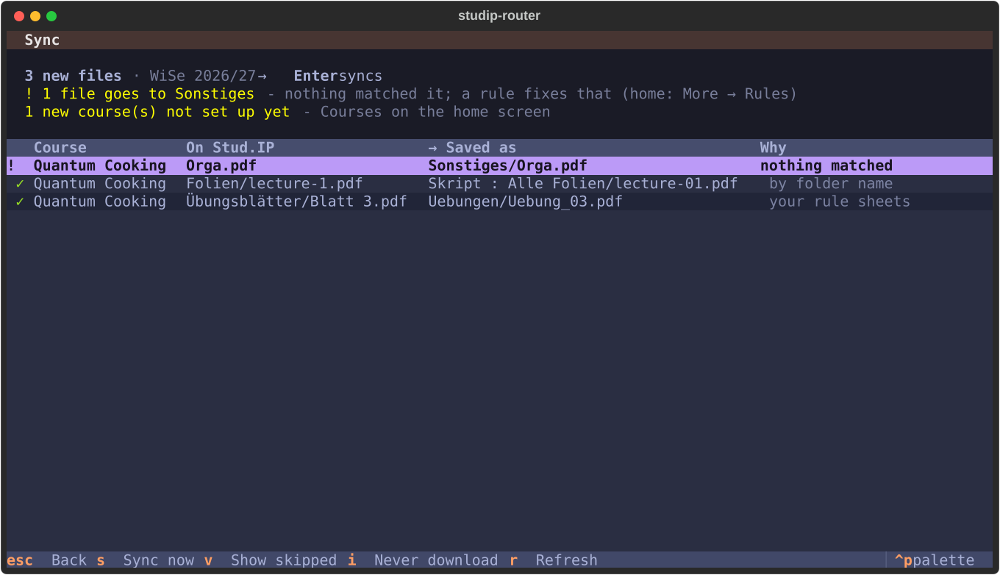
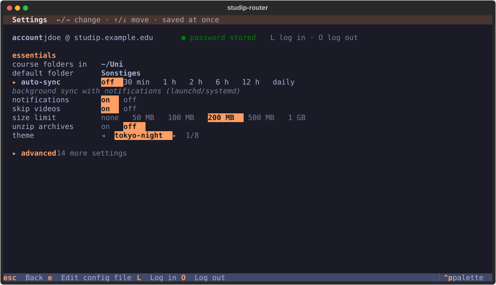
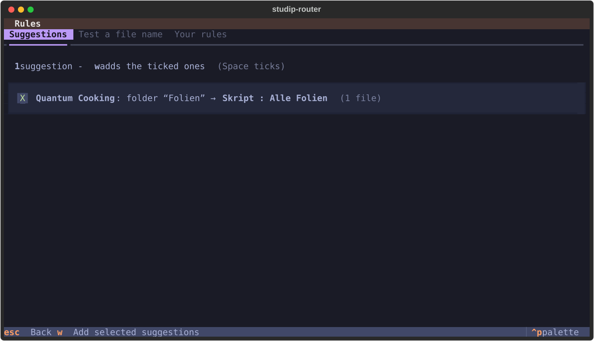
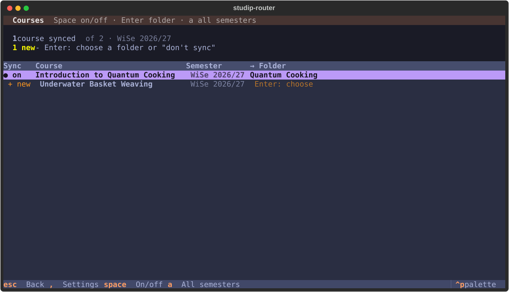
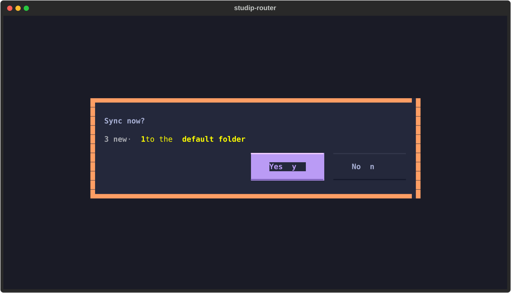
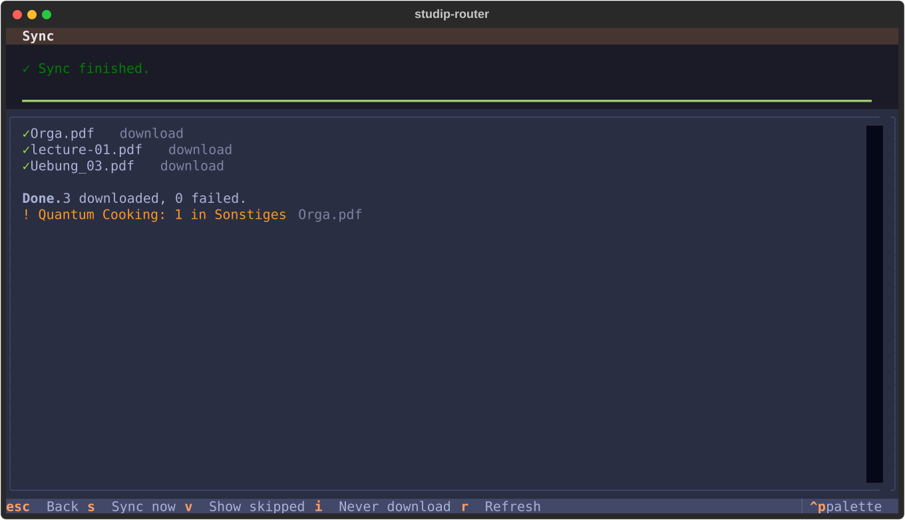

# Usage and workflows

[Back to the quick start](../README.md)

## Terms in one sentence

| Term | Meaning |
|---|---|
| **Root** | The folder that contains your course folders, e.g. `~/Uni/Semester 5` (`sync.root`). |
| **Target** | Where a course or a rule puts its files, relative to the root or the course folder. |
| **Rule** | A per-course *if this file looks like X, put it into folder Y and name it Z*. **First match wins.** |
| **Auto-route** | No rule matches, but the Stud.IP folder name (`Übungen`, `Slides`, …), a homework folder or — when the folder says nothing — the file name (`Uebungsblatt_3.pdf`, `VL03.pdf`) is clear: the file goes to your matching folder. |
| **Default folder** | Where files go that no rule matches (`sync.default_target`, e.g. `Sonstiges`). |
| **Suggestion** | A rule the tool proposes by comparing Stud.IP folder names with your local folder names (German and English). |
| **Adopt** | A file you already downloaded by hand is *recorded* instead of downloaded a second time. |
| **Version** | A file that changed on Stud.IP is saved as `name_v2.pdf` next to the old one; nothing is replaced. |
| **Dry run** | Shows exactly what a sync would do without touching any of your files — it uses the same planner as the real run. |
| **Profile** | A separate config and state, e.g. for a second university (`--profile NAME`). |

---


## Usage

### The terminal UI

The home screen shows **one next step** — a new course or a new semester to set
up, files that landed in the default folder, a failed sync, or simply *Sync now* — and `Enter`
does it. Below are the everyday actions; *More* holds the rest. Every key works
whether its line is shown or not:

| Key | | Key | |
|---|---|---|---|
| `s` | **Sync now** (summary → confirm) | `r` | Rules: suggestions, test a file name |
| `p` | Preview every file and its target | `o` | Reorganize synced files (`u` undo) |
| `w` | What's new: open / reveal / preview | `m` | Merge slides: pick the folder, one PDF |
| `a` | Announcements | `t` | Dates: changes and exams |
| `c` | Courses: sync on/off, choose folders | `,` | Settings |
| `d` | Doctor: check the setup | `?` | all keys |
| `n` | New semester: folders, new courses, archive old ones | `+` | in preview: a rule for files like this one |
| `i` | in preview / what's new: never download this file | `b` | in preview: report a file the automatic sorting placed wrong (you check and send it) |

`j`/`k` and arrow keys move, `Enter` opens, `Esc` goes back.

<p align="center">
  
  
</p>

<sub>Left the preview — every file, its target and why it goes there; files bound
for the default folder are marked `!` and listed first, files not downloaded are
counted with their reason (`v` shows them).
Right the settings — saved immediately, comments in the config file are kept.</sub>

<details>
<summary><b>More screenshots</b>: rule suggestions, courses, sync</summary>

<p align="center">
  
  
</p>
<p align="center">
  
  
</p>

</details>

### The command line

Everything works without the UI:

```bash
studip init
```

```bash
studip rules suggest --write
```

```bash
studip sync --dry-run
```

```bash
studip sync
```

Setup, add the suggested rules, see exactly what would happen, do it.

---


## How it stays safe

| Promise | How |
|---|---|
| **Nothing is ever deleted** | files removed on Stud.IP are only reported. |
| **Nothing is overwritten unnoticed** | name clashes get a suffix, updates become `_v2`; `overwrite` mode never replaces a file you edited (size/mtime/hash check against the state, repeated right before the file is replaced, so an edit made while the preview is open is kept too). |
| **Dry run == real run** | both use the same planner; the real run only executes the plan and re-checks every file before it writes. A dry run touches none of your files (it only creates the state database and log). |
| **Downloads are atomic** | `name.part`, fsync, rename, fsync of the folder. Ctrl-C leaves no partial files. |
| **Your password stays put** | only in the OS keychain (or `STUDIP_ROUTER_PASSWORD`) — never in the config, state, logs or output; crash reports of the UI show no variable values. A rejected login stops at the first attempt and pauses auto-sync, so a wrong password cannot lock your account. |
| **Config edits are checked** | settings screen and rule suggestions validate before writing; the first change keeps a `config.toml.bak`. |
| **Private files** | state database and log (course names, paths) are readable only by you (`0600`, folder `0700`). |
| **Stays on your machine** | the only server contacted is your `server.base_url`; no telemetry. Update check only if you turn it on (*update check* in the settings: pypi.org once a week, nothing sent). |

Found a security problem? See [SECURITY.md](https://github.com/nbomers/studip-router/blob/main/SECURITY.md).

---


## Tricky files

<details>
<summary><b>What happens with odd names, broken downloads, iCloud & co.</b></summary>

| Situation | What happens |
|---|---|
| `:` `*` `?` `"` `<` `>` `\|` in names | replaced (`Kapitel 1: Intro` → `Kapitel 1 - Intro`), so the folder also syncs to Windows/OneDrive/iCloud for Windows (`rename.portable`) |
| names longer than 255 bytes (umlauts count twice) | shortened, extension kept, room left for `_v2` |
| `/`, control and bidi characters, leading dot, trailing dots/spaces, `CON`/`NUL`… | made safe (`Lösung\u202Efdp.exe` cannot pose as a PDF) |
| `&amp;` & co. in Stud.IP names | decoded |
| file without extension | added from the MIME type (`Blatt 1` + PDF → `Blatt 1.pdf`) |
| upper/lower case, NFC/NFD (`ü` vs `u` + `¨`) | treated as the same name; no duplicates |
| two files want the same name | `name_2.pdf` (or skip/report) |
| hand-downloaded `Homework_1.pdf` vs `Homework 1.pdf` on Stud.IP | recognised as the same file |
| interrupted download, wrong size | retried; never leaves half files |
| Stud.IP sends a login/error page instead of the file | rejected and reported, retried next time |
| Stud.IP reports a slightly wrong size | accepted once two downloads agree; a file far bigger than announced (or than the size limit) is stopped while downloading |
| `[b]`, `[link=…]` in titles, file names or announcements | shown as text, never as formatting or a clickable link |
| a server that pages endlessly or repeats pages | stopped; every record is used once |
| one file fails | the others continue; the failed one is retried next sync |
| files only in iCloud (also old `.name.icloud` placeholders) | never downloaded just to compare |
| ZIPs with garbled umlaut names, ZIP-slip, ZIP bombs | names repaired and made safe, unsafe archives refused (more than 1 GiB, 20 000 entries or a compression ratio above 200:1) |
| `H2O`, `Python3`, `IPv6`, `A4`, `2x2` | left alone by number padding (only standalone numbers are padded) |
| renamed / moved / re-uploaded on Stud.IP | followed; identical content is never stored twice |
| two syncs at once (auto-sync + manual) | the second one stops with a message instead of racing |
| crash or power loss mid-download | leftover temp files are cleaned up after a day |
| university CA or TLS-inspecting proxy | the operating system's certificate store is used |
| link to an external site redirects elsewhere | your credentials are never sent to the other host; redirects to plain `http://` are refused |

</details>

---


## FAQ

<details>
<summary><b>My folders have different names than in the examples.</b></summary>

That's the point: targets are whatever folders you have. `studip init`, the rule
suggestions and automatic routing detect them (German and English, with or
without umlauts) and never pick archive folders like `old` or `Archiv`. Files
whose Stud.IP folder says nothing clear (`Tag 1`, `Material`) go to the default
folder; add a rule for those.

</details>

<details>
<summary><b>I already downloaded files by hand. Will they be downloaded twice?</b></summary>

No. A file with the same name (spaces, `_`, `-` treated alike) and size anywhere
in the course folder is recorded instead. A same-named file with different
content that you fetched this semester is treated as an older version: the new
one goes next to it as `_v2`.

Limit: a hand-downloaded file with the same name **and** the same size is not
compared byte by byte (that would mean downloading it). If you keep an unrelated
file under exactly the remote name, rename it before the first sync.

</details>

<details>
<summary><b>I deleted a file locally. Will it come back?</b></summary>

Yes, the next sync downloads it again. Files you never want: press `i` on them
(preview or what's new), `studip ignore add NAME`, a rule with `skip = true`, or
`sync.exclude`.

</details>

<details>
<summary><b>The lecturer renamed or re-uploaded a file. Do I get duplicates?</b></summary>

No. A rename or move on Stud.IP renames your local copy (unless you edited it).
A re-upload under the same name becomes `name_v2.pdf` — or nothing at all if the
content is identical.

</details>

<details>
<summary><b>What happens at the end of the semester?</b></summary>

Courses of the next semester show up a few weeks before it starts. The home
screen then offers *New semester* (`n`, or `studip semester` on the command line):

- **a folder for the new semester**, when your root is named after one
  (`Semester 5` → `Semester 6`, `WiSe 2026-27` → `SoSe 2027`); otherwise the new
  course folders go next to the old ones. Old courses keep their folders: their
  targets are written out in full;
- **a folder per new course**, with the subfolders your current courses share;
- **archive** courses that have ended: they are no longer synced, your files stay.
  Courses that have not ended yet keep syncing unless you archive them (retake
  exams, late solutions). `studip semester --read-only` also makes the files of
  archived courses read-only (`chmod -R u+w FOLDER` undoes it).

After a course has ended the home screen asks once more whether to archive it.
An archived course can be turned on again under `c`. Older semesters:
`studip sync --semester "SoSe 2026"`, `--semester all`, or `a` in the courses screen.

</details>

<details>
<summary><b>Does it get the files inside Courseware?</b></summary>

Turn on *courseware* in the settings (or per course in the config).
`studip doctor` tells you which of your courses use Courseware. Videos are
skipped by default (*skip videos*).

</details>

<details>
<summary><b>Which date changes are reported?</b></summary>

After every sync the course dates are compared with the last check:
**cancelled** (and taking place again), **moved** (new day or time),
**room changed**, **removed**, and **new exam dates** (category *Klausur* /
*Prüfung*). Only dates that are still ahead count. The first check of a course
only remembers its dates, so a new semester starts quietly; a room filled in for
the first time is no news either.

Background syncs send one notification for all changes. `studip dates` (or `t`)
shows the changes of the last two weeks and your upcoming exams. Turn it off with
*watch dates* in the settings.

</details>

<details>
<summary><b>A course protects every PDF with the same password.</b></summary>

```bash
studip pdf-password set "Quantum Cooking"
```

The password goes into the OS keychain. PDFs of the course synced so far are
unlocked right away, every new one during the sync — the date stays the Stud.IP
date, and an identical re-upload still creates no copy.

Left untouched, byte for byte: other files, PDFs without a password, PDFs that
open without one (print/copy restrictions only), and PDFs locked with a
**different** password. If the password fits none of them, the course probably
uses one password per file; then unlocking does not help —
`studip pdf-password remove COURSE`.

> [!NOTE]
> Lecturers usually lock PDFs because the material is only licensed for course
> participants. Unlocking your own copy is fine; do not put the unlocked files in
> a shared folder.

</details>

<details>
<summary><b>iCloud: evicted files, two Macs, <code>Skript / Alle Folien</code></b></summary>

- **Files "optimised" away** are fine: evicted files are never downloaded for
  comparison. Keep the state outside synced folders (the default).
- **Two Macs with the same iCloud folder:** run auto-sync on one of them only;
  two machines downloading the same file at the same time make iCloud create
  "Name 2.pdf" conflict copies.
- **A folder is called `Skript / Alle Folien` in Finder** but the tool says it
  does not exist: macOS shows `:` as `/` in Finder. On disk it is
  `Skript : Alle Folien` — use that in the config. `studip doctor` points this out.

</details>

---

